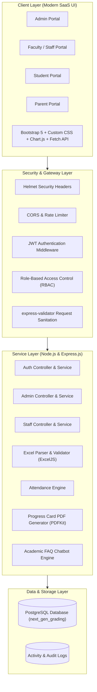
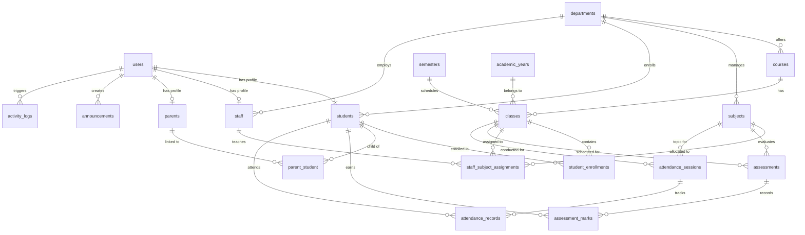

# Academic Department Assistance System (Next Gen Grading)

A modern, enterprise-grade academic management, automated grading, attendance monitoring, and digital progress card platform designed for higher education institutions.

---

## 1. Project Overview & Architecture

### Purpose
The Academic Department Assistance System automates academic progress monitoring and report card generation:
1. **Eliminates error-prone manual marks compilation** from disparate spreadsheets into a unified PostgreSQL database.
2. **Automates attendance percentage calculations** directly from recorded session logs.
3. **Enforces granular Role-Based Access Control (RBAC)** across four user roles: **Admin**, **Staff / Faculty**, **Student**, and **Parent**.
4. **Excel Marks Ingestion Workflow**: Download pre-formatted `.xlsx` templates, drag-and-drop upload, row-by-row validation with error alerts, preview verification, and ACID transaction commits with audit logging.
5. **Generates high-fidelity PDF Progress Cards** using `PDFKit` with institutional branding, subject-wise assessment marks, attendance breakdown, and authorized signature blocks.
6. **Academic Assistant Chatbot**: Pre-seeded knowledge base covering attendance regulations, internal assessment calculations, condonation criteria, and study tips.

---

### Architectural Overview



---

## 2. Technology Stack

- **Frontend**: HTML5, CSS3 (Navy Blue `#0f172a`, White, Teal `#0d9488`), Bootstrap 5, FontAwesome 6, Chart.js, Fetch API.
- **Backend**: Node.js, Express.js (RESTful architecture).
- **Authentication**: JWT (JSON Web Tokens), bcryptjs (12 salt rounds), Role-Based Access Control (RBAC).
- **Database**: PostgreSQL 18 with connection pooling (`pg.Pool`), parameterized queries, check constraints, foreign keys, and indexes.
- **File & Document Processing**:
  - `ExcelJS`: Template generation, workbook parsing, row-level validation.
  - `Multer`: In-memory multipart file upload with MIME type and size checks.
  - `PDFKit`: Vector-drawn student academic progress cards.
- **Security**: Helmet, express-rate-limit, express-validator, dotenv.
- **Testing**: Node.js built-in test runner (`node --test`).

---

## 3. Database Schema & ER Diagram



---

## 4. User Roles & Capabilities

| Feature | Administrator | Faculty / Staff | Student | Parent |
|---|:---:|:---:|:---:|:---:|
| System KPI Dashboard | ✅ | ❌ | ❌ | ❌ |
| Manage Students & Staff | ✅ | ❌ | ❌ | ❌ |
| Manage Departments & Subjects | ✅ | ❌ | ❌ | ❌ |
| Allocate Subjects to Faculty | ✅ | ❌ | ❌ | ❌ |
| Record Daily Attendance | ✅ | ✅ | ❌ | ❌ |
| Download Excel Marks Template | ✅ | ✅ | ❌ | ❌ |
| Upload & Validate Marks (Excel) | ✅ | ✅ | ❌ | ❌ |
| View Class Roster & Progress Cards | ✅ | ✅ | ❌ | ❌ |
| View Personal Academic Marks | ❌ | ❌ | ✅ (Read-only) | ❌ |
| View Personal Attendance % | ❌ | ❌ | ✅ (Read-only) | ❌ |
| Download Personal Progress Card PDF | ❌ | ✅ | ✅ | ❌ |
| Switch Linked Children & View Wards | ❌ | ❌ | ❌ | ✅ |
| Download Ward Progress Card PDF | ❌ | ❌ | ❌ | ✅ |
| Academic Assistance Chatbot | ✅ | ✅ | ✅ | ✅ |

---

## 5. Pre-Seeded Demo User Credentials

The database comes pre-populated with active demonstration accounts. You can use the **1-Click Quick-Fill** buttons on `/login.html` or enter the credentials below:

| Role | Username | Password | Linked Profile / Details |
|---|---|---|---|
| **Administrator** | `admin` | `Admin@123` | Institutional Administrator |
| **Faculty / Staff** | `staff1` | `Staff@123` | Dr. Sarah Jenkins (HOD - CSE) |
| **Faculty / Staff** | `staff2` | `Staff@123` | Prof. Alan Turing (Assistant Professor) |
| **Student** | `student1` | `Student@123` | Alex Turner (`REG2023CSE001`, CSE-A Sem 5) |
| **Student** | `student2` | `Student@123` | Bella Chen (`REG2023CSE002`, CSE-A Sem 5) |
| **Parent** | `parent1` | `Parent@123` | Robert Turner (Father of Alex Turner) |
| **Parent** | `parent2` | `Parent@123` | Meiling Chen (Mother of Bella Chen) |

---

## 6. Installation & Setup Guide

### Prerequisites
- **Node.js** (v18.0.0 or higher recommended)
- **PostgreSQL** (v14 or higher)

### Step 1: Clone or Navigate to the Workspace
```powershell
cd "G:\next gen"
```

### Step 2: Configure Environment Variables
Copy `.env.example` to `.env` (or update existing `.env`):
```env
PORT=5000
NODE_ENV=development
APP_NAME=Next Gen Grading - Academic Department Assistance System
APP_URL=http://localhost:5000

# PostgreSQL Database Configuration
DB_HOST=localhost
DB_PORT=5432
DB_NAME=next_gen_grading
DB_USER=postgres
DB_PASSWORD=your_postgres_password

# Authentication
JWT_SECRET=super_secret_academic_jwt_token_key_change_in_production_2026
JWT_EXPIRES_IN=24h
BCRYPT_SALT_ROUNDS=12
```

### Step 3: Install Dependencies
```powershell
cd "G:\next gen\backend"
npm.cmd install
```

### Step 4: Initialize & Seed Database
Run the database migration runner to create tables and load seed data:
```powershell
node src/utils/initDb.js
```

### Step 5: Start the Backend Server
```powershell
node src/server.js
```
The server will start listening on `http://localhost:5000`.

### Step 6: Access the Application
Open your browser and navigate to:
- **Public Portal**: [http://localhost:5000/](http://localhost:5000/)
- **Unified Login**: [http://localhost:5000/login.html](http://localhost:5000/login.html)
- **API Health Check**: [http://localhost:5000/api/health](http://localhost:5000/api/health)

---

## 7. Automated Test Suite

The project includes unit and integration tests covering security, password hashing, RBAC, Excel import/validation, PDF generation, and chatbot responses:

To run all 39 test suites:
```powershell
cd "G:\next gen\backend"
npm.cmd test
```

### Test Coverage Highlights:
- **Authentication**: JWT generation, expiry handling, tamper detection, login rate limiting, password comparisons.
- **RBAC**: Enforces strict boundaries between Admin, Staff, Student, and Parent.
- **Excel Ingestion**: Pre-formatted template generation, multi-point row validation (max marks, attendance check, duplicate detection, un-enrolled students), ACID transaction commit with audit logging.
- **Progress Card**: Calculation of accurate aggregate marks, subject attendance percentage, and `PDFKit` document stream generation.
- **Chatbot**: Accurate FAQ response matching and domain-specific academic heuristic fallback.

---

## 8. License & Institutional Attribution
Developed for Higher Education Institutions and Autonomous Colleges. © 2026 Next Gen Grading. All rights reserved.
